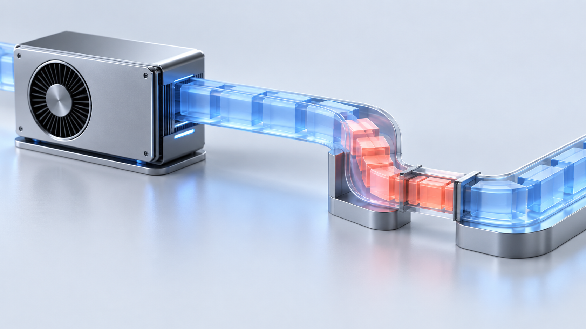

# Before Buying More GPUs, Fix Your Video Pipeline

*The expensive part may be getting frames to the GPU, keeping them there, and moving them out on time.*



*A faster GPU cannot remove a queue somewhere else in the pipeline.*

Take a video service that starts falling behind as more streams arrive. Playback gets later. Memory usage climbs. Someone opens a capacity request for another GPU machine.

That might be the right purchase. I would still want to follow one frame through the service before approving it.

Where does it wait? Which thread moves it forward? How many times does it cross between CPU and GPU memory? What happens when the destination cannot accept it?

I've worked on native video systems and RTSP-to-WebRTC bridges. That background makes me interested in the gaps between the named components. A diagram can say “hardware decode” and “hardware encode” while leaving out a download, a CPU filter, an upload, and a blocking write between them.

Those gaps deserve a place in the capacity discussion.

## Start with the video you actually need

Before measuring a pipeline, write down its output requirements.

A live preview needs recent frames. A recording needs a clear policy for preserving video and reporting gaps. An offline export might mainly need to finish quickly. These jobs can share code, but their definitions of success are different.

For a live service, specify the expected resolution, frame rate, codec, and acceptable delay. Decide what can happen under overload too. Can the preview skip frames? Can the source lower its bitrate? When must the service reject another stream?

Without those decisions, “supports more streams” is an incomplete result. A service that accepts every connection but delivers video several seconds late may already be over capacity.

Then ask whether the job needs decoded frames at all.

FFmpeg's stream-copy path transfers encoded packets without decoding and encoding them again. When the destination accepts the existing codec and stream parameters, remuxing into a suitable container can avoid that work. It does not support filters that need decoded frames, and container compatibility still matters. [1](https://ffmpeg.org/ffmpeg.html#Streamcopy)

A recording or relay path is worth checking here. Decoding video just to encode the same thing again should be a deliberate choice. Perhaps the output needs another codec, resolution, or bitrate. Perhaps it doesn't.

## Draw the memory path

A useful pipeline sketch shows more than component names:

```text
encoded packets
    -> hardware decoder
    -> decoded frames in GPU memory
    -> resize or format conversion, if needed
    -> hardware encoder
    -> encoded packets
    -> network or storage
```

Now mark every place a frame leaves GPU memory. Also mark where the code waits for another operation to finish.

In NVIDIA's FFmpeg guide, `-hwaccel cuda -hwaccel_output_format cuda` selects a hardware decode path with frames kept in GPU memory. Compatible GPU filters and hardware encoding can then continue that path. A CPU filter inserted between those stages may require a download and a later upload. Check the complete filter chain and the capabilities of your installed build. [2](https://docs.nvidia.com/video-technologies/video-codec-sdk/13.0/ffmpeg-with-nvidia-gpu/index.html)

The raw data adds up quickly. NV12 stores 8-bit YUV 4:2:0 video at 12 bits per pixel, or 1.5 bytes per pixel before padding. [3](https://learn.microsoft.com/en-us/windows/win32/medfound/recommended-8-bit-yuv-formats-for-video-rendering) For a tightly packed 1920 × 1080 frame, the payload calculation is:

```text
1920 × 1080 × 1.5 = 3,110,400 bytes per frame
3,110,400 × 30 = 93.312 MB per second
```

Here, MB means one million bytes. At 30 frames per second, downloading every frame and uploading it again moves about 186.6 MB per second of raw payload per stream. Forty streams would move about 7.46 GB per second across those two directions combined.

That is arithmetic, not a benchmark. It excludes row padding, alignment, other copies, and transfer overhead. It also does not mean 7.46 GB per second travels in each direction, or that every machine will hit a bus limit at that rate.

It gives you something specific to investigate: a small CPU operation between two GPU stages can require moving a surprisingly large amount of data.

When reading native code, I would look for the reason behind each copy. Does the consumer need its own buffer? Is the format incompatible? Did a convenient library API quietly force the data through host memory? Some copies will be necessary. Others may be leftovers from an earlier design.

## Check which part of the GPU is busy

“GPU utilization is low” needs a second question: which utilization?

NVIDIA's monitoring tools distinguish general GPU activity from encoder and decoder activity. The `nvidia-smi` documentation also distinguishes memory utilization from the amount of allocated framebuffer memory. Metric support varies by device and configuration; an unavailable reading is not evidence that an engine is idle. [4](https://docs.nvidia.com/deploy/nvidia-smi/index.html)

A video workload can put pressure on dedicated codec hardware while leaving much of the general compute capacity available. A low general GPU percentage therefore does not establish spare decoding or encoding capacity.

Collect those readings alongside CPU usage, input and output rates, transfer activity, and queue age. They need to cover the same interval. Comparing yesterday's average GPU graph with today's worst stream tells you very little.

The useful observation is a relationship. Perhaps output slows while encoder activity stays high. Perhaps every engine looks quiet while one CPU thread is busy. Perhaps output only falls behind when the storage destination slows down.

Each observation points to a different next measurement. None is a diagnosis by itself.

It is also worth looking at individual streams. An average can hide one expensive input format, one unstable source, or a few sessions that retain buffers much longer than the others. A fleet total is helpful for capacity planning; a per-stream timeline helps explain where that capacity went.

## A frame can be waiting for its own buffer

Memory usage does not have to grow forever for buffer ownership to hurt throughput. A fixed pool can run out of available surfaces because downstream work is still holding them.

NVIDIA's NVDEC guide makes two details explicit. `cuvidMapVideoFrame()` waits for decoding to complete. Calling it on the thread that submits decode work can prevent that thread from submitting more work while it waits. Mapped output surfaces must also be released with `cuvidUnmapVideoFrame()`; only a limited number may remain mapped. [5](https://docs.nvidia.com/video-technologies/video-codec-sdk/13.0/nvdec-video-decoder-api-prog-guide/index.html)

For code using that API, inspect the lifetime of a surface from acquisition to release. A reference held by an encoder, a queue, or an error path can matter just as much as the allocation itself.

Returning a surface too early is not a performance fix. If asynchronous work still reads it, reuse can corrupt the result. The release point has to follow the actual completion of the last consumer.

This is one reason I like ownership to be visible in the code. A frame handle should make it possible to answer who currently owns the data and what event makes it reusable. A raw pointer passed through several callbacks makes that question harder.

Adding another worker thread can help when submission is blocked. It can also add more outstanding work to the same exhausted pool. I would measure the wait and understand the lifetime before increasing concurrency.

## Bigger queues can make a live service worse

Suppose a source produces 30 frames per second and a downstream stage can sustain only 25. An unbounded queue gains five frames every second. A larger queue delays the moment when the system must deal with that mismatch.

It also lets the video get older.

For a live preview, I care about how long the oldest frame has been waiting. A queue with ten frames has a different meaning at 5 fps and 60 fps. Count and byte limits protect resources; an age limit expresses something closer to the viewing requirement.

GStreamer's `queue` element supports limits and can either block or discard buffers when full, depending on its configuration. These are different overload policies, with different consequences. [6](https://gstreamer.freedesktop.org/documentation/coreelements/queue.html)

Choose the policy at the right stage. Dropping an old decoded frame before presentation may be acceptable for a live preview. Arbitrarily dropping compressed data can damage later frames that depend on it. A recording branch needs its own decision about gaps, buffering, and failure reporting.

Give the viewer and recording writer separate branches with finite budgets. Separate threads alone do not provide lasting isolation if both branches eventually block on shared buffers or shared output work.

When a budget is exhausted, make the result observable. Count intentional drops. Report recording gaps. Reject work if necessary. A service that silently accumulates delay is difficult to operate because its failure arrives long after its capacity was exceeded.

## The recent SDK work is worth reading

NVIDIA's July 31, 2026 article about Video Codec SDK 13.1 describes updated transcoding samples with separate submission work and queues between stages. It also introduces `AppTransZeroCopy`, which can share suitable CUDA arrays between decode and encode instead of using an intermediate copy and conversion. [7](https://developer.nvidia.com/blog/nvidia-video-codec-sdk-13-1-zero-copy-transcode-av1-b-frames-and-frame-accurate-seek/)

The interesting part is the treatment of memory ownership and scheduling as part of video performance. These are concrete examples to study when inspecting a similar path in your own application.

The sample's benefits depend on a compatible path, including hardware, driver, format, and processing requirements. “Zero copy” in one handoff does not mean that an entire application moves no data. Nor does installing a newer SDK automatically reorganize an existing pipeline.

I would use the sample to form a specific hypothesis: perhaps this intermediate surface or synchronization point is avoidable. Then I would check that hypothesis against the application's actual output requirements.

## Measure a change you can explain

Start with a repeatable workload and keep a small record of the test conditions: GPU model, driver, FFmpeg or SDK version, codecs, resolution, frame rate, encoder settings, and destination.

The input needs to match the question. Reading a local file as quickly as possible can help measure processing capacity. It does not reproduce a live source's pacing, reconnects, or network variation. I would use both kinds of test when the service has to handle both conditions.

Record four things together:

- Useful output: completed frames or playable output at the required settings.
- Delay: time spent inside measured stages and queues, including the slower cases.
- Resource use: CPU, relevant GPU engines, memory, transfers, and output I/O.
- Failure behavior: drops, errors, reconnects, and recovery after overload.

Local timing should use a monotonic clock. Capture-to-display delay is a separate measurement and needs a trustworthy relationship between the source and destination clocks.

Change one part of the path. Remove an unnecessary host round trip, shorten a surface lifetime, or isolate a slow output. Repeat the same workload and check output correctness as well as speed.

For diagnosis, a temporary discard sink can show whether a real output destination is holding things up. The final capacity test still needs that destination. Otherwise, the result leaves out work the deployed service must do.

Let the test run long enough to expose a growing backlog. A short burst can look healthy while its queues borrow time from the rest of the system. Recovery matters too: after input load falls, does latency return to normal, or does the service keep showing old video?

Only then would I increase stream count and look for the first requirement the service can no longer meet.

## Make the hardware request specific

Sometimes the result will be clear: the required codec engine is saturated, memory capacity is insufficient, or the application needs more independent processing capacity. More hardware may be exactly the right answer.

The investigation is still useful. It tells you which resource to buy and what additional capacity to expect under the tested conditions.

Other times, a GPU spends part of its day waiting for frames, a free surface, or an output writer. Another GPU might leave those waits untouched.

Before buying it, follow one frame. Find out where its time goes.

## Sources

1. [FFmpeg: Streamcopy](https://ffmpeg.org/ffmpeg.html#Streamcopy).
2. [NVIDIA: Using FFmpeg with NVIDIA GPU Hardware Acceleration, SDK 13.0](https://docs.nvidia.com/video-technologies/video-codec-sdk/13.0/ffmpeg-with-nvidia-gpu/index.html).
3. [Microsoft: Recommended 8-Bit YUV Formats for Video Rendering](https://learn.microsoft.com/en-us/windows/win32/medfound/recommended-8-bit-yuv-formats-for-video-rendering).
4. [NVIDIA: NVIDIA System Management Interface documentation](https://docs.nvidia.com/deploy/nvidia-smi/index.html).
5. [NVIDIA: NVDEC Video Decoder API Programming Guide, SDK 13.0](https://docs.nvidia.com/video-technologies/video-codec-sdk/13.0/nvdec-video-decoder-api-prog-guide/index.html).
6. [GStreamer: queue](https://gstreamer.freedesktop.org/documentation/coreelements/queue.html).
7. [NVIDIA: Video Codec SDK 13.1 — Zero-Copy Transcode, AV1 B-Frames, and Frame-Accurate Seek](https://developer.nvidia.com/blog/nvidia-video-codec-sdk-13-1-zero-copy-transcode-av1-b-frames-and-frame-accurate-seek/), July 31, 2026.

---

*I'm Burak Hamuryen, a software engineer in Berlin working on distributed systems and real-time video infrastructure. More at [hamuryen.com](https://hamuryen.com).*
