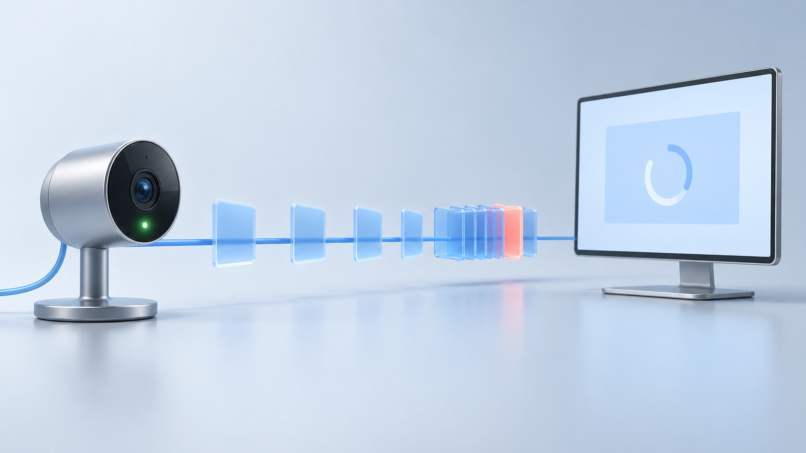

# Your Camera Is Online. Is the Video Still Live?

*A connected session tells you much less than an advancing video stream.*



*The connection is healthy. The frames still have somewhere to go.*

A camera can answer requests while its video stops moving. A relay can receive packets while a viewer gets no new frames. A player can run smoothly while showing video that is several seconds old.

All three can sit behind the same green “online” label.

I've worked on video systems that bridge camera protocols, native services, and browser playback. One thing I want from their monitoring is a clear answer to a small question: where did progress stop?

That answer needs more than a successful connection or a running process. It needs evidence from the media path.

Here is how I would build that evidence, using transport, timing, decoding, and playback signals. The goal is to detect delivery problems without interpreting what appears in the picture.

## Give “online” a smaller meaning

An online state can be useful. It might mean the service recently contacted the camera, an RTSP session exists, or the transport remains connected.

Keep that meaning. Add separate observations for the video.

The path might contain a camera, an ingest service, a relay, a recorder, and a browser. Each can be running while the next stage waits. A status endpoint only proves whatever work the endpoint actually checks.

MediaMTX provides a useful example of separate transport observations. Its metrics include session state, inbound and outbound traffic, RTP packet loss, and packet errors. These give more detail than a connection count alone. [1](https://mediamtx.org/docs/features/metrics)

They still describe the server's view. A relay that forwards compressed video without decoding it cannot report whether a downstream decoder produced a usable frame. A server that sent bytes cannot prove the browser presented them.

Keep those limits visible. “Receiving video packets” is an honest and useful status. Calling it “live playback healthy” adds a claim that needs another measurement.

## Track the last useful progress at each stage

For each active stream, record when useful work last advanced. The exact measurements depend on what the application does, but the questions are stable:

| Stage | Evidence of progress | What it does not prove |
|---|---|---|
| Ingest | New video media packets arrive | A complete frame can be decoded |
| Decode | The decoder produces another frame | The viewer presents it |
| Playback | A new frame is submitted for presentation | It was captured recently |
| Recording | Recorded media time advances in completed output | That output survives every storage failure |
| Monitoring | A fresh observation arrives | The stream itself is healthy |

Keep audio and video separate. Audio packets can continue while the video track stalls. Keep control traffic separate too; a keepalive is not video progress.

For a local stage, the basic age calculation is small:

```text
progress age = current monotonic time - last local progress time
```

Both times must come from the same clock domain. A monotonic clock measures elapsed time without depending on wall-clock corrections. Raw monotonic timestamps from different machines cannot be subtracted this way.

A stage that has never produced output needs a startup state, not a fabricated “last frame” timestamp. After a reconnect, begin a new observation period and retain the previous failure in the history.

This turns a vague complaint into something you can inspect. In a constructed example, packets and decoded frames keep advancing, while presentation has not advanced for several seconds. I would first investigate the path from decoded output to the player. Restarting the camera would be a poorly targeted first response.

## Smooth playback can still be late

There are two different questions: is video advancing, and how old is it?

A player can display 30 frames per second from a queue that is three seconds behind the source. Its frame rate looks healthy. Its live delay does not.

You need an age measurement to tell those cases apart. Unfortunately, a media timestamp is not automatically a capture time you can subtract from the current clock.

RTP timestamps use a media clock with an arbitrary starting point. RTCP sender reports can associate an RTP timestamp with an NTP-format timestamp, but that mapping still depends on the sender's clock and timestamp behavior. Jitter measures variation in transit timing; it is not a measurement of total end-to-end delay. [2](https://www.rfc-editor.org/rfc/rfc3550)

Name each measured delay after its actual endpoints. “Time from gateway ingest to gateway output” is useful. Calling it “camera-to-screen latency” would hide the time spent before and after the gateway.

Where a trustworthy capture-time mapping is available, use it and document its limits. Where it is missing, track local queue age and stage delay, and leave absolute capture freshness unknown.

An honest partial measurement gives an operator somewhere to start. A precise-looking number built from unrelated clocks can send the investigation in the wrong direction.

There is another limit worth stating. A camera could repeatedly encode the same picture while sending valid packets and advancing timestamps. Transport and timing signals alone cannot reliably distinguish that from a legitimate still scene. This monitoring design detects delivery and progress failures; it does not establish whether the pictured scene is changing.

## Measure the player's side of the connection

For WebRTC playback, the statistics API exposes several stages separately. Received frames, decoded frames, packet timing, and rendering-related freeze or pause measurements can help narrow down a problem. Availability needs checking in the browsers you support. [3](https://www.w3.org/TR/webrtc-stats/)

Some of those measurements describe completed intervals. The specification updates pause and freeze information around rendered frames; a pause count increments when rendering resumes after the pause. I would not rely on that counter alone to detect a stall that is still happening. [3](https://www.w3.org/TR/webrtc-stats/)

The page needs a current progress observation as well.

`requestVideoFrameCallback()` runs when a new frame is sent to the compositor and exposes presentation-related metadata. It can help track whether the video element is advancing. The callback runs on the main thread, and the API does not guarantee exact synchronization with physical display output. [4](https://developer.mozilla.org/en-US/docs/Web/API/HTMLVideoElement/requestVideoFrameCallback)

That distinction matters during diagnosis. If the page's main thread is blocked, the callback can be late too. If the user paused playback or the page is in the background, the application's expectations need to change.

Report playback intent and page state alongside the timing. “Expected to play, visible, no presentation progress” is much more useful than “no callback.”

Client reports also have a delivery path of their own. If those reports stop reaching the backend, the backend has lost visibility. It has not proved that the camera stopped sending video.

## Turn observations into states carefully

A single timeout for every stream is tempting. It also ignores how streams behave.

A low-frame-rate source has a different expected gap from a 30 fps preview. A newly connected decoder may need time to produce its first frame. An on-demand stream may correctly be idle until someone starts watching it.

Begin with explicit expectations for each stream class: whether media should be flowing, how often progress is expected, and how much startup time is allowed.

The active stream can then move between a few states:

- **Starting:** the stream is expected, but it has not established normal progress yet.
- **Healthy:** the required observations are fresh and within their budgets.
- **Degraded:** progress continues, but a delay or error budget is exceeded.
- **Stalled:** an expected stage has stopped advancing beyond its allowed gap.
- **Unknown:** the observations needed to make the decision are missing or stale.

An intentionally idle stream sits outside the active-stream evaluation. It should not create a stream failure merely because no viewer requested it.

The thresholds should come from the service requirement and the stream's expected behavior. I would record the reason for every transition: ingest stopped, decode stopped, presentation stopped, or delay grew too large.

Require sustained recovery before clearing an alert. One packet after a long silence is evidence of contact, but it does not establish stable playback.

The classifier itself should not have to watch every frame centrally. Each component can maintain its local progress and send compact summaries. Detailed timing can be retained around a transition, when it is most useful for diagnosis.

## Read counters across a useful interval

A total packet-loss counter answers how much loss has accumulated over its lifetime. The change over a recent interval helps answer what is happening now.

Compare observations from the same stream session. A reconnect, process restart, or replacement statistics object can reset a counter. Keep the session identity with the samples and start a new baseline when it changes. Do not treat a reset as a sudden negative rate or uninterrupted success.

Preserve incident history outside the live session object. Reconnecting can restore the stream while making its new counters look perfectly clean.

Loss, jitter, and errors help explain degraded delivery, but no single one is a universal failure threshold. A receiver may recover some lost data. A stream can also stall without packet loss if a downstream stage stops consuming it.

GStreamer's RTP jitter buffer illustrates the tradeoff: it reorders packets and waits within a configured latency budget. Waiting can help with late arrivals, while adding delay to the path. Its settings and drop observations belong in the investigation. [5](https://gstreamer.freedesktop.org/documentation/rtpmanager/rtpjitterbuffer.html)

Look for changes together: rising queue age, slower decode output, late packets, and stalled presentation. Agreement between independent observations is more useful than a red threshold on an isolated graph.

## Recording needs its own health signal

A live viewer and a recorder can fail independently. A healthy player does not prove the recording is progressing, and a growing file does not prove the latest video is available for playback.

For a segmented recorder, I would track the most recently completed segment, the media interval it covers, and whether it can be opened and decoded. I would separately track whether that segment reached the intended storage destination.

This check does not need to interpret the frames. It checks the container, timestamps, and decodability. It should also account for audio-only progress rather than assuming any file growth means new video was saved.

The expected completion interval depends on the recording format and segment policy. An unfinished segment can be normal. A health rule that ignores that will produce false alarms at regular intervals.

A slow recorder can also affect another branch if they share work or buffers. GStreamer's `tee` documentation calls for a separate queue or multiqueue in each branch so a blocked branch does not immediately stall the others. Finite queues still need an overload policy once they fill. [6](https://gstreamer.freedesktop.org/documentation/coreelements/tee.html)

Missing recorded time should be explicit. Buffering, rejected work, and storage failure should lead to a visible result that the operator can distinguish from a complete recording.

## Test the green status, not just the reconnect

Before trusting these states, I would create failures in a small test setup and check the reported timeline.

Start with a sender that can stop video while keeping its control path alive. The expected result is a media-progress failure even if the connection stays open.

Then hold packets long enough to create delay while allowing them to keep arriving. Check that advancing counters do not hide old video. Slow a downstream consumer separately, so the monitoring can distinguish ingest progress from output progress.

Test a slow recording destination while watching live playback. Pause the player deliberately. Put the page in the background. Stop the component that reports metrics. Each case should produce a reason that matches what actually happened, including “unknown” when observation is lost.

Finally, reconnect the stream and let it recover. Check startup handling, reset counters, alert clearing, and retention of the previous gap. A test that ends at the first successful reconnect misses much of the behavior an operator will depend on.

These tests establish what the health labels mean. They also expose cases where the application does not yet have enough information to make a reliable claim.

I would still keep the small green connection light. Beside it, I would want to see where video last advanced, how much delay we can actually measure, and when those observations were updated.

That gives the next engineer something better than “the camera is online.” It gives them a place to look.

## Sources

1. [MediaMTX: Extract metrics](https://mediamtx.org/docs/features/metrics).
2. [RFC 3550: RTP — A Transport Protocol for Real-Time Applications](https://www.rfc-editor.org/rfc/rfc3550), especially sections 5.1 and 6.4.1.
3. [W3C: Identifiers for WebRTC's Statistics API](https://www.w3.org/TR/webrtc-stats/), including inbound RTP and video pause/freeze definitions.
4. [MDN: HTMLVideoElement.requestVideoFrameCallback()](https://developer.mozilla.org/en-US/docs/Web/API/HTMLVideoElement/requestVideoFrameCallback).
5. [GStreamer: rtpjitterbuffer](https://gstreamer.freedesktop.org/documentation/rtpmanager/rtpjitterbuffer.html).
6. [GStreamer: tee](https://gstreamer.freedesktop.org/documentation/coreelements/tee.html).

---

*I'm Burak Hamuryen, a software engineer in Berlin working on distributed systems and real-time video infrastructure. More at [hamuryen.com](https://hamuryen.com).*
